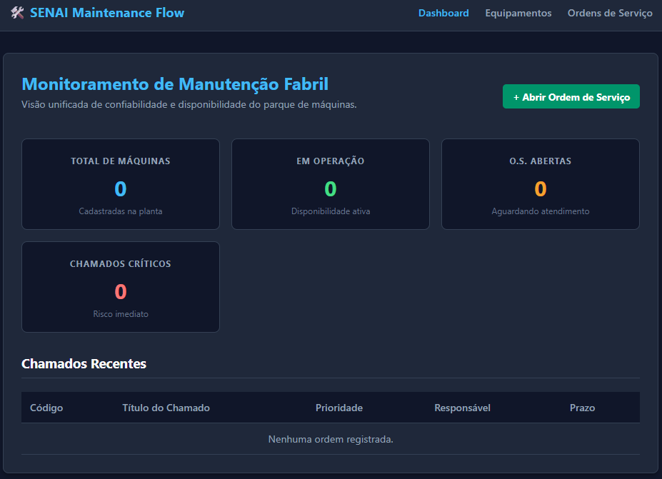
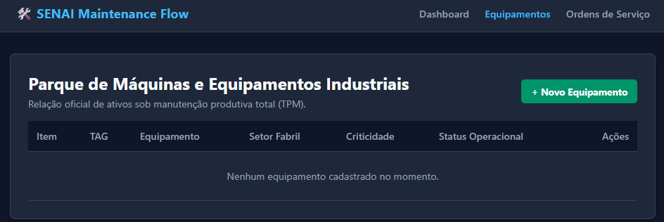
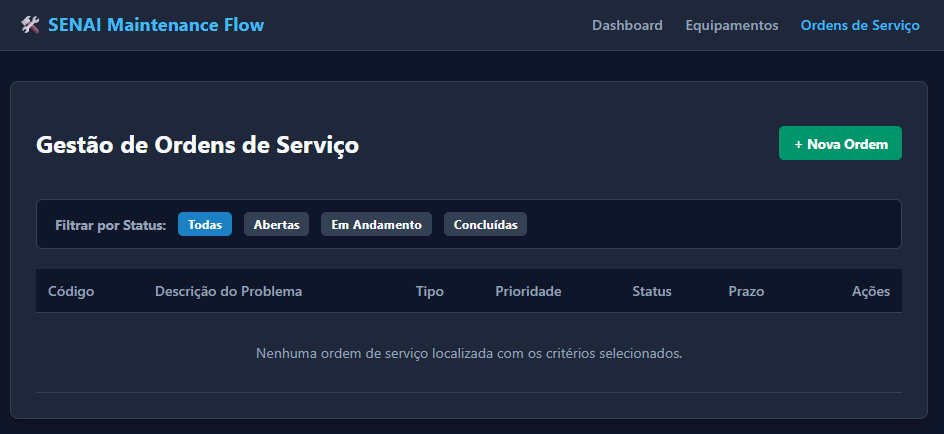
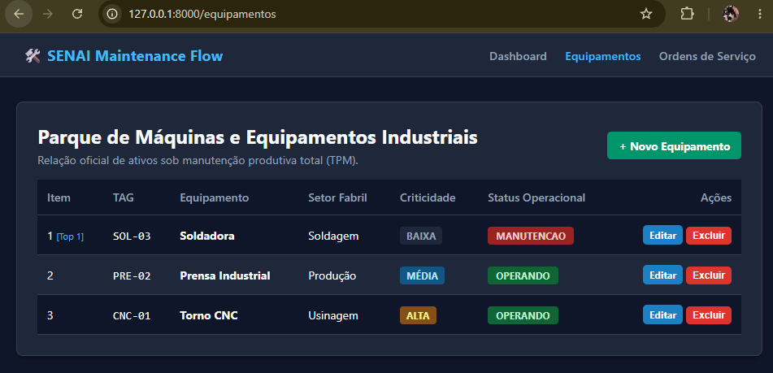
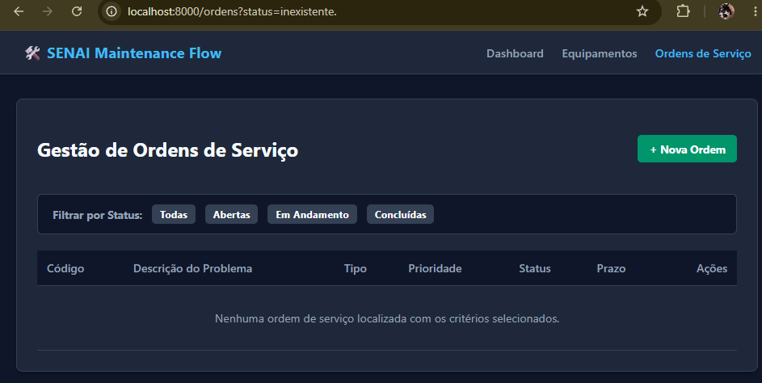
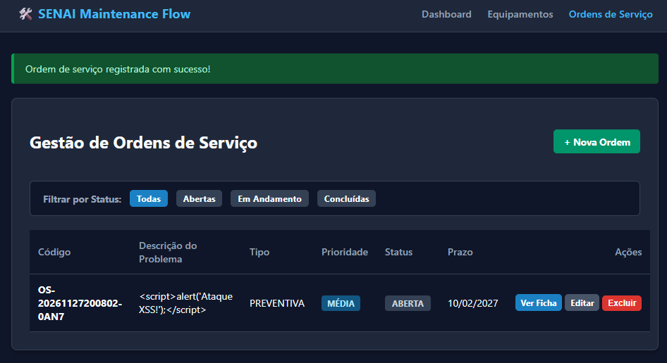

# 8 Testes de Validação Técnica:

#### Teste 1 — Renderização do Painel Principal:
Acesse `http://localhost:8000/`.
Resultado Esperado: O navegador é redirecionado para /dashboard. Os 4 cartões de KPIs são renderizados via `<x-card-kpi>` com suas respectivas cores.

#### Teste 2 — Validação do Layout Mestre Compartilhado:
Navegue entre os links "Dashboard", "Equipamentos" e "Ordens de Serviço".
Resultado Esperado: A barra superior e o rodapé permanecem idênticos sem piscar ou recarregar a estrutura básica, com a classe CSS `.ativo` no link da rota atual `(request()->routeIs(...))`.

**DashBoard:**

**Equipamentos:**

**Ordens e Serviço:**

#### Teste 3 — Auditoria de Laço e Alternância de Linhas com `$loop`:
Acesse `http://localhost:8000/equipamentos`.
Resultado Esperado: A tabela de máquinas renderiza as linhas alternando as cores de fundo através de `$loop->even`, e o primeiro item exibe a etiqueta [Top 1] via $loop->first.

#### Teste 4 — Tratamento de Lista Vazia com `@forelse`:
Acesse `http://localhost:8000/ordens?status=inexistente`.
Resultado Esperado: A view exibe a mensagem de feedback elegante definida dentro do bloco `@empty`: "Nenhuma ordem de serviço localizada com os critérios selecionados".

#### Teste 5 — Auditoria de Defesa Ativa Contra XSS:
Cadastre uma nova O.S. pelo formulário em `/ordens/create` com o título:
``e acesse `/ordens`.
Resultado Esperado: O texto é exibido literalmente no corpo da tabela como texto puro. O alerta **nunca** é executado pelo navegador, comprovando a eficácia do escape automático do Blade.

#### Teste 6 — Inspeção das Views Compiladas em Cache:
Abra o diretório storage/framework/views no VS Code.
Resultado Esperado: Arquivos .php com hashes criptográficos gerados pelo Blade contendo chamadas nativas de echo e($variavel).

#### Teste 7 — Teste do Comando de Limpeza de Cache:
Execute no terminal: php artisan view:clear.
Resultado Esperado: Mensagem "Compiled views cleared successfully". Ao recarregar a página no navegador, novos arquivos compilados são gerados instantaneamente.

#### Teste 8 — Injeção Dinâmica de Scripts com @push e @stack:
Acesse a ficha técnica de uma O.S. cadastrada clicando em Ver Ficha em http://localhost:8000/ordens.
Abra o DevTools (F12 ➔ Elements) e role até o final do <body>.
Resultado Esperado: O bloco <script> do botão de impressão foi inserido exatamente na posição da diretiva @stack('scripts') do layout mestre.

