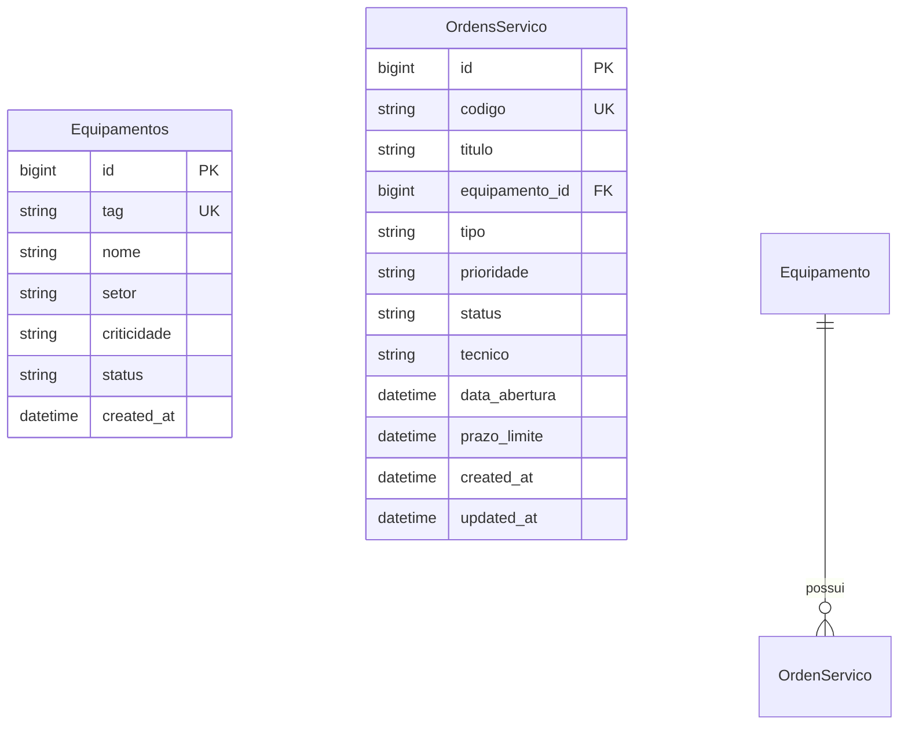

# Sistema de Manutenção SENAI - Estudo do View Blade

## Criação do Projeto usando composer 

```bash
composer create-project laravel/laravel sistema-manutencao-senai
```

## Configurar `.env`

Inserir as informações da base dados e a chave de criptografia caso necessário

```ini
DB_CONNECTION=pgsql
DB_HOST=127.0.0.1
DB_PORT=5432
DB_DATABASE=manutencao_senai
DB_USERNAME=postgres
DB_PASSWORD=postgres
```

>[!OBS]
> Criar o banco de dados `CREATE DATABASE manutencao-senai`

## Camada de Modelos de Domínio (`app/Models`)
Os Models são responsáveis por encapsular as regras de negócio da aplicação, método de consulta e consistência dos dados.



Comando no Artisan
`php artisan make:model Equipamento - m`
`php artisan make:model OrdenServico -m`

## Criação da Camada de Controllers (`app/Http/Controllers`)

São métodos que aplicam a injeção de dependências e organizam a lógica antes de invocar a view correspondente

`php artisan make:controller DashboardController --resource`
`php artisan make:controller EquipamentoController --resource`
`php artisan make:controller OrdemServicoController --resource`


