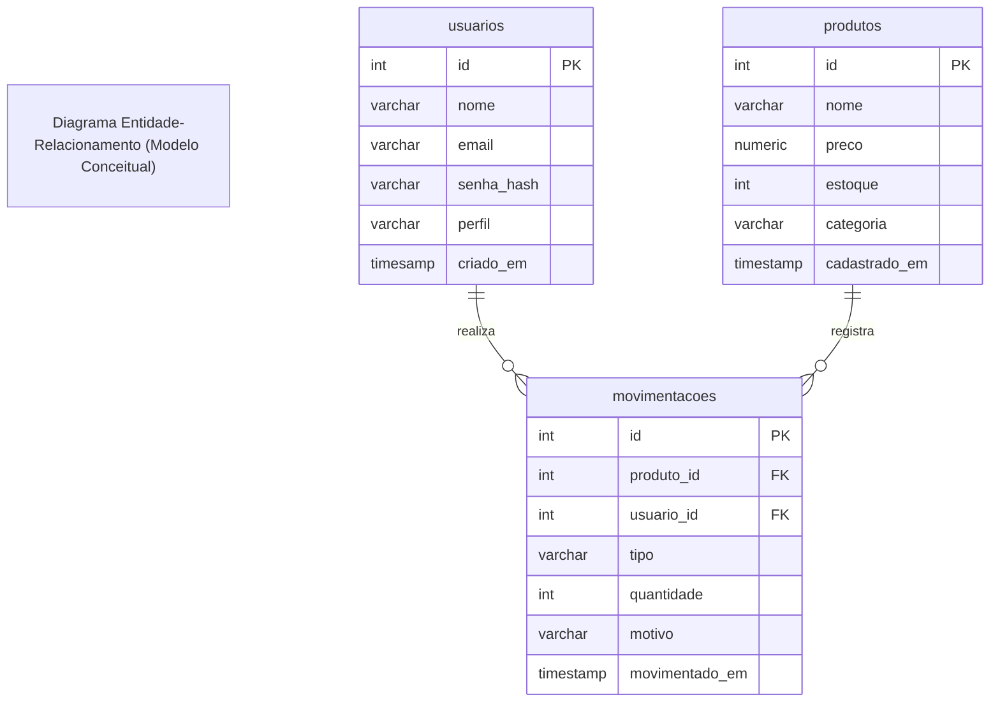

# SENAI Supply MVC - Especificações de Requisitos do Sistema - Documentação em Formato ISO 29148

## 1. Identificação

- Projeto: SENAI Supply MVC
- Versão: 1.0
- Responsável: Equipe de Desenvolvimento (I1D46B)

## 2. Objetivo

Desenvolver uma aplicação web didática em arquitetura MVC Artesanal com PHP 8.3+;
PostgresSQL, Composer (PSR-4), controle estrito de autenticação por sessão 
Interceptação de rotas por Guards/Middlewares, registro transacionais (ACID) de Movimentação de estoque e gravação constinua de logs de auditoria corporativa

## 3. Escopo

### 3.1 Contextualização

Na manufatura 4.0, sistemas legados com código espaguete geram gargalos de produção, falhas de segurança e inconsistências graves de estoque. Como desenvolvedor(a) back-end júnior na fábrica do SENAI, sua equipe foi convocada para refatorar e modernizar o SENAI Supply, substituindo scripts desorganizados por uma arquitetura corporativa Model-View-Controller (MVC) artesanal.
O sistema deve blindar o acesso por perfis de operadores, garantir a integridade atômica das movimentações físicas de insumos e manter uma trilha contínua de auditoria em arquivos de log protegidos.

### 3.2 Orientação do Desenvolvimento

- Autenticação com senhas criptografadas
- Controle de acesso baseado em papéis (RBAC) com Guards
- Elaboração das regras de Négocio e aplicação em Camadas MVC
- Padrão Front Controller e Autoload PSR-4
- Controle Transacional do Banco de Dados (ACID - Atomicidade, Consistência, Isolamento, Durabilidade)
- Serviço de Auditoria de Logs

## 4. Requisitos do Sistema

### 4.1 Requisitos Funcionais

- **RF-001** - Autenticação de Usuários: O sistema deve autenticar o usuário por e-mail e senha
- **RF-002** - Logout Seguro: O encerramento da sessão deve ocorrer exclusivamente via `POST/logout`
- **RF-003** - Guard de Autenticação: Rotas restritas devem direcionar usuário para login
- **RF-004** - Autorização por Perfil: restrição de Rotas por Perfil de Usuário
- **RF-005** - Catálogo de Produtos: `GET` listar produtos
- **RF-006** - Cadastrar Produtos: `POST` persistir novo produto
- **RF-007** - Atualizar Registro de Produtos: `UPDATE` de produtos
- **RF-008** - Registro de Movimentação: `POST`movimentação
- **RF-009** - Validação de Movimentações: impedir movimentações indevidas
- **RF-010** - histórico de Movimentações: `GET` listar as movimentações
- **RF-011** - Registro de Logs: armazenar eventos de logs em logs/app.log

### 4.2 Requisitos Não Funcionais (RNF)

- **RNF-001** - Segurança de Senhas: Usar criptografia para salvar as senhas no banco
- **RNF-002** - Integridade Transacional (ACID): Movimentações devem usar PDO
- **RNF-003** - Prevenção XSS: sanitização de dados `htmlspecialchars`
- **RNF-004** - Utilização de Arquitetura MVC: utilização de Model-View-Controller Artesanal

# Diagramas do Sistema

### Diagrama de Entidade Relacionais (DER)



## Estrutura Completa de Diretórios do Projeto

Crie rigorosamente a seguinte árvore de pastas e arquivos no seu espaço de trabalho

```text
senai-supply-mvc/
├── README.md                   <- Requisitos e critérios de aceitação
├── composer.json               <- Mapeamento de Autoload PSR-4
├── config/
│   └── database.ini            <- Credenciais isoladas do Banco de Dados
├── logs/
│   └── app.log                 <- Arquivo de logs e auditoria da aplicação
├── public/
│   └── index.php               <- Front Controller (Ponto único de entrada)
├── schema.sql                  <- DDL de usuários, produtos e movimentações
└── src/
    ├── Controllers/
    │   ├── AuthController.php          <- Login, autenticação e logout
    │   ├── HomeController.php          <- Dashboard e métricas de estoque
    │   ├── MovimentacaoController.php  <- Registro e auditoria de movimentações
    │   └── ProdutoController.php       <- Catálogo e cadastro de insumos
    ├── Core/
    │   ├── ConexaoBanco.php    <- Provedor Singleton de conexão PDO
    │   ├── Controller.php      <- Classe base abstrata com renderização e CSRF
    │   ├── Guards/
    │   │   └── AuthGuard.php   <- Middleware/Guard de autenticação e perfis
    │   ├── Logger.php          <- Serviço centralizado de logs da aplicação
    │   └── Roteador.php        <- Roteador HTTP artesanal com suporte a Guards
    ├── Models/
    │   ├── Movimentacao.php    <- Regras e transação de movimentação (ACID)
    │   ├── Produto.php         <- Regras de negócio e catálogo de insumos
    │   └── Usuario.php         <- Persistência e busca segura de usuários
    └── Views/
        ├── layout/
        │   ├── header.php      <- Cabeçalho com sessão, perfil e logout
        │   └── footer.php      <- Rodapé corporativo compartilhado
        ├── auth/
        │   └── login.php       <- Formulário de autenticação com CSRF
        ├── home/
        │   └── index.php       <- Dashboard com métricas gerais
        ├── movimentacoes/
        │   ├── historico.php   <- Tabela de auditoria de movimentações
        │   └── novo.php        <- Formulário para registrar entrada ou saída
        └── produtos/
            ├── criar.php       <- Formulário de novo insumo
            └── listar.php      <- Tabela de insumos com atalho de movimentação
```

## Etapas do Desenvolvimento

### Modelagem Ralacional e Script DDL (`schema.sql`)

Criar o Banco de Dados e Executar o Script SQL para Criação das Tabelas

### Configuração do Autoload PSR-4 (`composer.json`)

Criar o arquivo `composer.json` na raiz do projeto

### Criar a Conexão com o Banco de Dados

#### Criar o arquivo `config/database.ini`

#### Criar o Arquivo ConexaoBanco (`src/Core/ConexaoBanco`)

### Criar a Classe de Looger do sistema (`src/Core/Looger.php`)